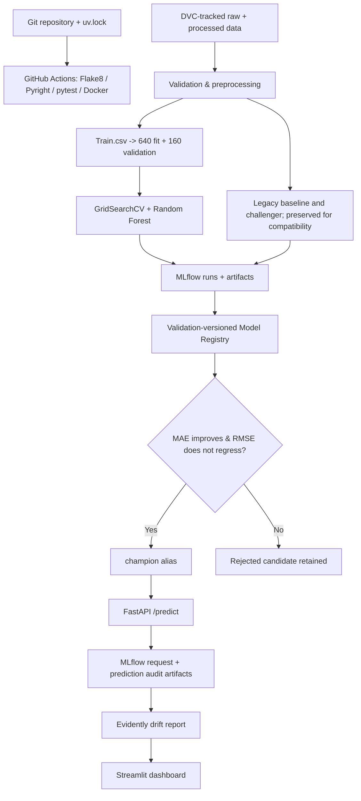

# GitHub Stars — End-to-End MLOps / MLSecOps Project

**A reproducible, containerized regression service for predicting GitHub repository stars, with MLflow experiment tracking, validation-gated model promotion, DVC data versioning, FastAPI inference and training, Evidently drift reports, Streamlit monitoring, and GitHub Actions quality gates.**
 
**Author:** Laura Mészáros · **Python:** 3.13 · **Dependency manager:** uv  
**Status:** Academic demonstration; the local system has been demonstrated with successful API calls, model registry operations, Docker containers and DVC fresh-clone recovery. The latest CI status should be checked on GitHub.

> **Scope and safety.** This is a local academic environment, **not a publicly secured production deployment**. Compose exposes the services on `127.0.0.1`. The optional `/train` API key is not enabled unless explicitly configured. Do not expose the services to the internet unchanged!

## Contents

1. [Goal and dataset](#goal-and-dataset)
2. [Architecture](#architecture)
3. [Quick start with Docker](#quick-start-with-docker)
4. [API endpoints](#api-endpoints)
5. [Model training and promotion](#model-training-and-promotion)
6. [Experiment tracking and artifacts](#experiment-tracking-and-artifacts)
7. [Monitoring: Evidently and Streamlit](#monitoring-evidently-and-streamlit)
8. [DVC data versioning and fresh-clone recovery](#dvc-data-versioning-and-fresh-clone-recovery)
9. [Development, tests and CI](#development-tests-and-ci)
10. [Evidence screenshots](#evidence-screenshots)
11. [Results, caveats and limitations](#results-caveats-and-limitations)
12. [AI-assisted development](#ai-assisted-development)
13. [Submission notes](#submission-notes)

## Goal and dataset

The model at hand is **supervised regression**: estimate a repository's GitHub star count (`stars`) from repository-level metadata. The main MLOps goal is **not to maximize a single reported metric**, but to build a traceable process that can evaluate a challenger and **prevent the automatic replacement of a validated champion by a worse candidate**.

The starting dataset is a privacy-oriented, anonymized top-1,000 GitHub repositories CSV. Original repository and owner names are not used as predictors. The source for the CSV is Kaggle, licensed **CC0 / Public Domain**.

| Role | Column | Type / interpretation |
| --- | --- | --- |
| **Target (excluded from features)** | `stars` | Non-negative integer: number of GitHub stars |
| Categorical input | `language` | Primary programming language |
| Numeric inputs | `forks`, `open_issues`, `age_days` | Fork count, open issues, age in days |
| Binary inputs | `has_coc`, `has_contributing`, `has_workflows`, `has_readme` | Presence of common governance, contribution and automation files |

**Observed dataset dimensions:** 1,000 rows and 9 columns. The initial data check found no missing values and no fully duplicated rows. All four Boolean features are normalized to `0/1`. The preprocessing code validates the data contract and rejects unsupported columns, missing values, negative counts and malformed flags.

The deterministic preparation stage writes:

```text
data/
├── raw/mlsecops_prep_set.csv
├── processed/repositories_clean.csv   # 1,000 validated rows
├── processed/train.csv                # 800 rows
├── processed/test.csv                 # 200 rows; final holdout
└── validation/                        # generated separately
    ├── fit.csv                       # 640 rows from train.csv
    ├── validation.csv                # 160 rows from train.csv
    └── validation_protocol.json
```

The **final 200-row test split is not used for validation-based model selection or promotion**. The internal validation group is derived only from the 800-row training split; a versioned protocol and source fingerprint make comparisons auditable.

## Architecture



The Docker Compose services are:

| Service | Role | Host URL |
| --- | --- | --- |
| `mlflow` | Tracking UI, SQLite-backed model registry and artifacts | http://localhost:5000 |
| `prepare-data` | One-off validated dataset preparation | Exits successfully after completion |
| `api` | REST training, prediction, health and model status | http://localhost:8000/docs |
| `dashboard` | Streamlit monitoring and Evidently HTML report | http://localhost:8501 |

MLflow data and artifacts persist in the named Docker volume `mlflow-state`. The API and dashboard use the internal hostname `http://mlflow:5000` rather than the host-loopback address.

## Quick start with Docker

### Prerequisites

- Git
- Docker Desktop with Docker Compose v2
- Python **3.13**, uv and DVC (for local development and dataset recovery)
- Access to the DVC remote configured in `.dvc/config` (see below)

### Clone, install, restore data

```powershell
git clone https://github.com/mlaura227/mlsecops-repo-stars.git
cd mlsecops-repo-stars
uv python install 3.13
uv sync --locked
```

The data files are tracked with **DVC**, not stored as large Git blobs. To download them, configure DagsHub credentials locally, then:

```powershell
uv run --locked dvc pull
uv run --locked python -m src.reproducibility --mode data
```

For credentials, use either `AWS_ACCESS_KEY_ID` and `AWS_SECRET_ACCESS_KEY` in a local environment, or DVC's **untracked** `.dvc/config.local`.

### Local environment

```powershell
Copy-Item .env.example .env
```

For the validated production-like workflow, add to local **`.env`**:

```dotenv
MLSECOPS_TRAIN_WORKFLOW=validation
MLSECOPS_SERVING_MODEL_NAME=github-stars-regressor-validation-v1
```

The `legacy` training mode remains available for rollback. The two registry settings are **independent**, so `/train` and `/predict` must be configured consistently when demonstrating the validated workflow.

### Start everything

```powershell
docker compose up --build -d
# Inspect the four services, including the completed prepare-data job:
docker compose ps --all
```

The startup command is a single Compose command **after its prerequisites (DVC data and configuration) are in place**. On the first run, building Python, MLflow and their dependencies can take several minutes. Do not run `docker compose down -v` unless you explicitly intend to delete the persisted MLflow volume.

On a **new** tracking database, a champion alias does not exist until one candidate has been accepted. With the validation workflow enabled, use Swagger's `POST /train` or:

```powershell
docker compose exec api python -m src.validation_training --tracking-uri http://mlflow:5000 --auto-promote
```

Once an approved `champion` exists, `GET /model-status` and `POST /predict` can resolve it. On subsequent identical runs a challenger can be **rejected** with HTTP 200; this is a correct, intended gate decision.

Stop the stack with `docker compose down` (without `-v`).

## API endpoints

FastAPI provides an OpenAPI/Swagger interface at **http://localhost:8000/docs**.

| Method | Endpoint | Behavior |
| --- | --- | --- |
| `GET` | `/health` | Service liveness |
| `GET` | `/model-status` | Serving registry, champion version, training registry and validation protocol |
| `POST` | `/train` | Run selected training workflow, log an audit record and optionally promote the challenger |
| `POST` | `/predict` | Validate the eight features, load the current approved champion, predict stars and log an MLflow audit event |

### Train request

```json
{
  "auto_promote": true,
  "min_mae_improvement": 0.01,
  "random_state": 42
}
```

A validation-training response records `training_workflow: "validation"`, the registered model name/version, baseline and challenger metrics, the protocol ID and the promotion decision. `baseline_run_id` is `null` for that workflow because the baseline metrics are logged within the validation candidate's MLflow run. **`promotion_accepted: false` does not mean training failed**.

### Predict request

```json
{
  "language": "Python",
  "forks": 1250,
  "open_issues": 40,
  "age_days": 1500,
  "has_coc": true,
  "has_contributing": true,
  "has_workflows": true,
  "has_readme": true
}
```

The response contains `prediction`, `request_id`, `model_name`, `model_version` and `audit_run_id`. Pydantic rejects extra fields, invalid types and negative numeric counts with HTTP 422. When there is no approved champion, prediction is intentionally unavailable rather than silently selecting the latest model.

## Model training and promotion

There are two clearly separated tracks:

| Track | Purpose | Model Registry |
| --- | --- | --- |
| **Legacy** | Historical baseline/Random Forest comparisons using the original train/test split; retained for compatibility | `github-stars-regressor` |
| **Validation-based (recommended)** | Grid search within 640 training rows; validate on a fixed 160-row cohort; compare only compatible model versions | `github-stars-regressor-validation-v1` |

The training system uses scikit-learn **Pipelines**, so one-hot encoding, numeric imputation/scaling and the regressor form a single fit/predict artifact. This keeps transformation fitting inside the training fold and prevents target leakage (`stars` is never a feature).

The validation trainer uses a deterministic 640/160 internal split, **three-fold cross-validation** on the fitting subset, GridSearchCV and Random Forest hyperparameter selection based on MAE. It logs the split/protocol ID and dataset hash. A candidate's MAE must improve by the configured relative margin (e.g. 1%) and its RMSE must not regress versus compatible reference models. Comparison against a differently evaluated legacy champion is intentionally disallowed.

The accepted model gets the **`champion` alias**. Rejected versions remain registered for audit and do not displace the champion. Serving verifies accepted promotion tags and the versioned protocol when using the separate validation registry.

Commands for standalone experiments:

```powershell
# Run reproducible data preparation
uv run --locked python -m src.prepare_data

# Generate / inspect the versioned internal validation split
uv run --locked python -m src.validation_protocol

# Run research-only hyperparameter tuning (no automatic promotion)
uv run --locked python -m src.tuning --tracking-uri http://127.0.0.1:5000

# Train with the validation gate in the Compose network
docker compose exec api python -m src.validation_training --tracking-uri http://mlflow:5000 --auto-promote
```

## Experiment tracking and artifacts

MLflow tracks parameters, metrics, dataset hashes, trained models, model versions and promotions. Relevant artifacts include:

- Serialized scikit-learn Pipeline / registered model
- Train/validation evaluation predictions, CV search results, and validation protocol JSON
- Promotion decision and approval/rejection tags
- `api/train.json` and `api/predict.json` — request and outcome audit records
- `monitoring/predictions.csv` — feature and prediction rows for drift monitoring
- Evidently HTML and JSON reports logged in MLflow

The internal API, dashboard and MLflow containers share one tracking server and persistent volume. When testing locally **outside** Compose, set `MLFLOW_TRACKING_URI` explicitly to avoid accidentally creating a separate local registry.

## Monitoring: Evidently and Streamlit

Visit **http://localhost:8501**. The dashboard supports two data-source modes:

1. **Logged API predictions** — real calls to `/predict`, reconstructed from MLflow audit artifacts; requires a minimum number of records.
2. **Holdout split (demo only)** — compares the training and test feature distributions, explicitly labeled as a demonstration, **not real production drift**.

It computes Evidently's data drift report for **eight input features**. Stars and predictions are excluded from this feature-drift comparison. Reports are displayed in Streamlit and logged to MLflow as HTML and JSON artifacts.

In the captured demo report, **1 of 8 features (`language`) was marked drifted (12.5%)**, below the configured **50% dataset-level threshold**; therefore Evidently showed **no overall dataset drift**. A feature-level alert should not be misrepresented as dataset-level drift or as evidence of live production distribution change.

## DVC data versioning and fresh-clone recovery

DVC stores data objects remotely while Git stores the metadata. The shared DVC remote uses DagsHub's S3-compatible endpoint, **configured in committed `.dvc/config`**. Credential values belong only in environment variables or the untracked `.dvc/config.local`.

```powershell
uv run --locked dvc remote default
uv run --locked dvc status -c -r shared
uv run --locked dvc pull -r shared
uv run --locked python -m src.reproducibility --mode shared-remote
uv run --locked python -m src.reproducibility --mode data
```

A reproducibility preflight checks the **configuration**, not the ability to read from remote storage. Use `dvc pull` or the full smoke script to verify actual data recovery.

From PowerShell on Windows, after securely providing your DagsHub S3 credentials through `AWS_ACCESS_KEY_ID` and `AWS_SECRET_ACCESS_KEY`:

```powershell
.\scripts\verify_fresh_clone.ps1 `
  -RepoUrl (git remote get-url origin) `
  -Branch main
```

The script creates a temporary clone, runs `uv sync --locked`, checks the shared-remote metadata, runs `dvc pull` and validates the resulting dataset files. It removes the temporary clone on success. The screenshot [`10b_dvc_clone_pass.png`](docs/screenshots/10b_dvc_clone_pass.png) demonstrates a successful fresh-clone check on an earlier feature branch; rerunning against `main` is recommended for the final audit.

## Development, tests and CI

### Local development

```powershell
uv python install 3.13
uv sync --locked
uv run --locked pre-commit install

uv run --locked pyright
uv run --locked flake8 src tests
uv run --locked pytest -q --cov=src --cov=tests --cov-report=term-missing --cov-fail-under=95
uv run --locked dvc status
```

The quality policy follows the assignment:

| Gate | Requirement |
| --- | --- |
| Coverage | **At least 95%** across the `src/` **and test code**; branch coverage enabled |
| PEP8 style | Flake8, max line length **120** |
| Type checking | Pyright **gentle strict** on `src/`, **zero errors** |
| Git history | At least **50 author-specific commits**, meaningful changes, preserved feature-branch history |
| Containers | Docker Compose services, automatic startup dependencies, health checks |
| CI | Python checks plus Docker/Compose build validation on PRs and main |

The pre-commit hook runs the complete suite. If tests depend on several changed files, **stage all of those changes together before committing**: pre-commit temporarily hides unstaged files, so partially staged code can fail even when a manual local test passes.

GitHub Actions is in `.github/workflows/ci.yml` (and the optional DVC recovery workflow is under `.github/workflows/`). The local checks and GitHub Actions have been demonstrated passing; view the latest run for current status. Avoid declaring CI healthy based only on a previous green PR run.

To update and export exact dependencies after an intentional change:

```powershell
uv lock
uv sync --locked
uv export --locked --format requirements.txt --no-hashes --no-emit-project --no-dev -o requirements.txt
```

## Evidence screenshots

The following screenshots are stored in [`docs/screenshots/`](docs/screenshots/) and demonstrate concrete system behavior. Older shots are kept as development history; later ones are preferred for final evidence.

| Evidence | Screenshot(s) |
| --- | --- |
| MLflow regression runs | [`05_mlflow_experiments.png`](docs/screenshots/05_mlflow_experiments.png) |
| MLflow registry history | [`05_registry.png`](docs/screenshots/05_registry.png), [`08b_registry_champions.png`](docs/screenshots/08b_registry_champions.png) |
| Validated promotion gate; rejected challenger | [`08c_registry_validated_champion.png`](docs/screenshots/08c_registry_validated_champion.png) |
| Validation experiment / tuned model | [`07_validation_experiment.png`](docs/screenshots/07_validation_experiment.png), [`08b_validation_experiment.png`](docs/screenshots/08b_validation_experiment.png) |
| Live API `/train` (HTTP 200) | [`09_train_http200.png`](docs/screenshots/09_train_http200.png) |
| Live API `/predict` (HTTP 200) | [`09_predict_http200.png`](docs/screenshots/09_predict_http200.png) |
| Active champion API status | [`11_swagger_model_status.png`](docs/screenshots/11_swagger_model_status.png), [`08c_swagger_model_status.png`](docs/screenshots/08c_swagger_model_status.png) |
| Docker build/containers | [`08c_docker_compose.png`](docs/screenshots/08c_docker_compose.png), [`05_docker_stats.png`](docs/screenshots/05_docker_stats.png), [`11_docker_compose.png`](docs/screenshots/11_docker_compose.png) |
| Streamlit/Evidently report | [`06_dashboard1.png`](docs/screenshots/06_dashboard1.png), [`06_dashboard2.png`](docs/screenshots/06_dashboard2.png), [`06_dashboard3.png`](docs/screenshots/06_dashboard3.png) |
| DVC fresh-clone verification | [`10b_dvc_clone_pass.png`](docs/screenshots/10b_dvc_clone_pass.png) |
| Historical API demonstrations | [`08_swagger_train200.png`](docs/screenshots/08_swagger_train200.png), [`08_swagger_predict200.png`](docs/screenshots/08_swagger_predict200.png), [`08c_swagger_predict.png`](docs/screenshots/08c_swagger_predict.png), [`05_swagger.png`](docs/screenshots/05_swagger.png) |
| Github Actions | [`11_gh_actions_checked.png`](docs/screenshots/11_gh_actions_checked.png) |


## Results, caveats and limitations

- On the validation experiment shown in MLflow, the tuned challenger achieved **validation MAE about 20,137.41** versus the median baseline **about 24,436.58**, on the *same internal validation protocol*. This is not a direct comparison with the historical legacy holdout result.
- The validated registry demonstrated an accepted **version 1** and a subsequently **rejected version 2**, retaining `champion` on version 1. The algorithm correctly rejects repeated training when it does not improve the agreed metrics.
- **Data leakage controls:** `stars` is not a model feature; preprocessing is inside the scikit-learn pipeline; validation selection does not read the original test CSV. The 200-row holdout must remain reserved for unbiased final assessment.
- **Dataset limitations:** this is a small, observational and popularity-biased list of highly starred repositories. Inputs such as forks may correlate with stars without proving causality; results should not be generalized to arbitrary new repositories without additional validation.
- **Monitoring limitations:** the screenshot report uses holdout-data demo. Real drift monitoring requires a representative stream of logged prediction requests. Evidently's statistical detections are not themselves retraining triggers or guaranteed model-quality changes.
- **Deployment limitations:** SQLite MLflow storage and Docker Compose are suitable for the assignment, not for a multi-user cloud production deployment without stronger authentication, secret management, rate limits, backups and monitoring.
- **Optional Airflow:** not included in the functional Compose workflow; the optional extra-credit orchestration was intentionally not implemented.

## AI-assisted development

AI assistance (*on OpenAI GPT-6*) was used during iterative project development to plan the architecture, draft Python modules and tests, explain MLflow/DVC/FastAPI behavior and for documentation purposes. The implementation was verified through local Python 3.13 `uv` checks, pre-commit tests, GitHub Actions runs, Swagger calls, MLflow experiments and DVC fresh-clone testing. Suggested code was reviewed, corrected and committed iteratively. **AI output was not treated as evidence of successful execution without actual checks.**